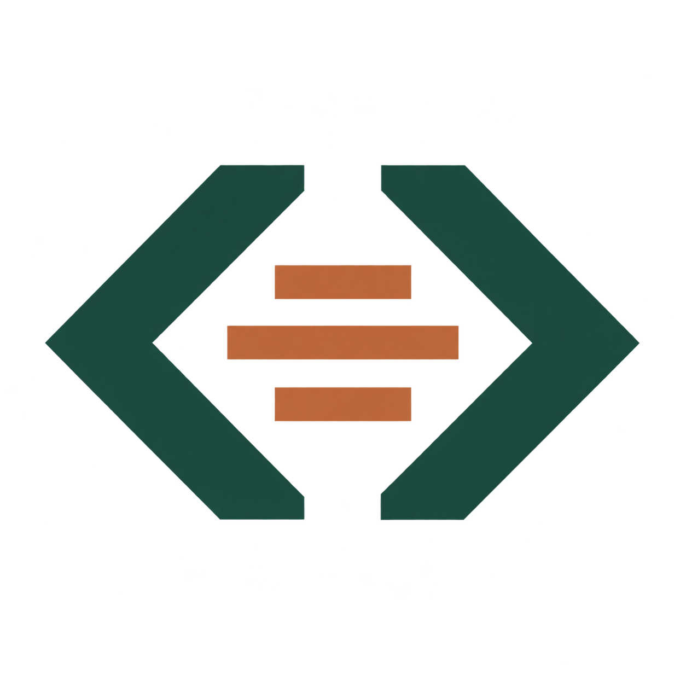
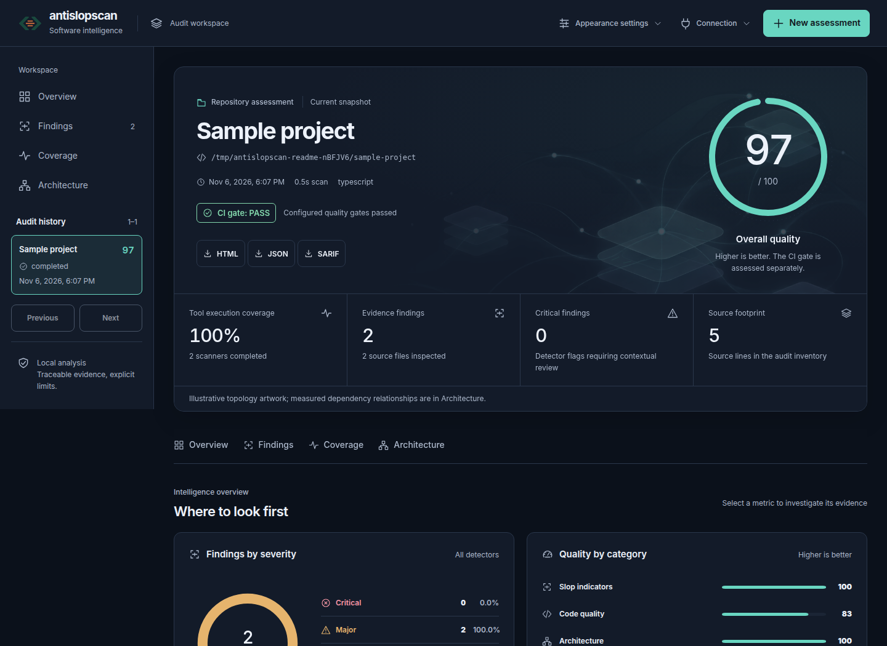

# AntiSlopScan

[](https://github.com/jfscoertzen/AntiSlopScan/actions/workflows/ci.yml) [](LICENSE.TXT) [](https://github.com/jfscoertzen/AntiSlopScan/releases)



**Understand the quality and structure of your codebase in one audit.**

AntiSlopScan is an open-source, self-hosted code audit appliance for developers,
architects and CI pipelines. It combines static-analysis tools with an independent
architecture and systems-thinking engine to surface code smells, duplication,
security indicators, dependency risks and maintainability concerns. Explore the
results in a web dashboard or produce standalone HTML, printable PDF, JSON and
SARIF reports.



*The dashboard above shows a real audit of a small sample fixture.*

### What you get

- **Evidence you can investigate:** filter findings by severity, file, rule and
  scanner; inspect recommendations, provenance and references.
- **Architecture in context:** review resolved dependency graphs, structural risk,
  design principles and systems-thinking assessments, with unassessable areas
  identified rather than treated as failures.
- **Clear quality gates:** inspect category scores, scanner coverage and CI status
  separately. Scanner failures remain visible and affect coverage.
- **Your choice of workflow:** run a one-shot CLI scan, use the self-hosted web
  interface, or integrate the API and machine-readable reports into CI.
- **Local by default:** scans work offline after installation. Source is treated as
  data; repository scripts and dependency installation are not run. Optional LLM
  review is disabled by default and requires explicit source-transmission consent.

## Quick start: Docker

The alpha image targets **Linux x86_64**. Mount your repository read-only and choose
an existing reports directory outside it:

```sh
docker run --rm --network none \
  -v /absolute/path/to/source:/workspace:ro \
  -v /absolute/path/to/reports:/reports \
  jfscoertzen/antislopscan:1.0.0-alpha.2 \
  cli --source /workspace --output /reports
```

The container runs as UID/GID 1000, so the source must be readable and the reports
directory writable by that user. Use `jfscoertzen/antislopscan:alpha` to follow the
current alpha image. The report directory receives HTML, PDF, JSON and SARIF.

Prefer a browser? Clone this repository and start the Compose appliance:

```sh
git clone https://github.com/jfscoertzen/AntiSlopScan.git
cd AntiSlopScan
ANTISLOPSCAN_SOURCE=/absolute/path/to/repositories docker compose up -d --build
```

Open [localhost:3000](http://localhost:3000). History persists in a Docker volume;
the source mount is read-only. See [Run with Docker](#run-with-docker) for security,
configuration and offline installation details.

## Local executable or npm package

Download the Linux x86_64 executable archive or npm tarball from
[GitHub Releases](https://github.com/jfscoertzen/AntiSlopScan/releases). The
executable archive bundles Node and production dependencies; it needs a compatible
glibc-based Linux system and `prlimit`:

```sh
mkdir antislopscan && cd antislopscan
# Extract antislopscan-1.0.0-alpha.2-linux-x64.tar.gz downloaded from Releases.
tar -xzf /path/to/antislopscan-1.0.0-alpha.2-linux-x64.tar.gz
./bin/antislopscan cli --profile portable --source /path/to/repository --output /path/to/reports
./bin/antislopscan gui --profile portable --source /path/to/repository
```

Verify downloads against the `SHA256SUMS` file provided with the release. The
portable profile runs the Node-based scanner set and produces HTML, JSON and SARIF.
Use the Docker image or the full local toolchain for native scanners and PDF.

To install the downloaded npm tarball globally with Node 22.22.3 or later:

```sh
npm install --global --ignore-scripts /path/to/antislopscan-1.0.0-alpha.2.tgz
antislopscan cli --profile portable --source /path/to/repository --output /path/to/reports
```

The npm package is available as a GitHub release artifact; it has not been
published to the npm registry. Continue below for profiles, configuration, API,
scoring, security limits and development instructions.

## Install the npm CLI

The npm release currently targets Linux x86_64 with glibc and Node 22.22.3+.
Build an installable release from this checkout:

```sh
npm ci
npm run package
npm install --global --ignore-scripts ./artifacts/antislopscan-1.0.0-alpha.2.tgz

antislopscan cli --profile portable --source /path/to/repository --output /path/to/reports
antislopscan gui --profile portable --source /path/to/repository
```

The tarball contains compiled CLI/UI assets, vendored rules and notices, and all
production npm dependencies verified against the authoritative lockfile. It can
be installed with an empty npm cache offline; no TypeScript build or project
checkout is needed. `portable` runs the independent engine,
ESLint, SlopScore, Oxlint, vendored Anti-Slop, jscpd, and dependency-cruiser, and
writes HTML, JSON and SARIF. Linux also requires util-linux's `prlimit`.

`full` is the default profile for existing Docker/CLI automation. It additionally
enables the native/Python scanners and PDF. Profiles supply defaults; explicit
JSON settings override them. Missing enabled tools and failed PDF rendering
remain visible and produce a failing operational status.

For full npm installation prerequisites and maintainer publication commands, see
[`docs/NPM_DISTRIBUTION.md`](docs/NPM_DISTRIBUTION.md). After this package is
published to the public npm registry, the registry installation command is
`npm install --global antislopscan`. Until publication, install the built tarball.

## Choose CLI or GUI

After completing the local installation below, run either mode from this checkout:

```sh
# CLI: write reports into the exact folder you choose.
./antislopscan cli --source /path/to/repository --output /path/to/reports

# GUI: start the browser workbench and open http://localhost:3000.
./antislopscan gui --source /path/to/repository
```

`cli` requires `--output`. It creates that folder if needed, writes the configured
HTML/PDF/JSON/SARIF reports there, prints its absolute location in the JSON
summary, and exits with the CI status. Keep the folder outside the source tree.
Quote paths containing spaces. Add `--config /path/to/config.json` to select an
audit policy. CLI mode starts no web server.

`gui` serves the web interface and REST API until stopped with Ctrl+C. `--source`
chooses the permitted repository root; it defaults to the current directory for
local execution. `--data /path/to/state` chooses persistent history and GUI report
storage. Its local default is `$XDG_STATE_HOME/antislopscan`, or
`~/.local/state/antislopscan` when that variable is unset. The container uses
`/workspace` and `/data`. Configure individual GUI audits in the browser.

The same modes are available as `npm run cli -- ...` and `npm run gui -- ...`.
After building, `npm link --ignore-scripts` optionally installs the
`antislopscan` command on your PATH from this checkout. `audit` and `serve` remain
compatible command aliases. `./antislopscan --help` lists modes and flags.
Docker users can select CLI or GUI as shown next without host development tools.

## Run with Docker

The alpha image is published as `jfscoertzen/antislopscan:alpha`. For a one-shot offline scan, mount your source read-only and a writable reports directory:

```sh
docker run --rm --network none \
  -v /path/to/source:/workspace:ro -v /path/to/reports:/reports \
  jfscoertzen/antislopscan:alpha cli --source /workspace --output /reports
```

The image runs as UID 1000; ensure the reports directory is writable by that user. For a self-hosted GUI, clone this repository and use the Compose command below. Release tags publish a versioned Docker image and a Linux x86_64 executable distribution through GitHub Actions; alpha builds are prereleases.

The pinned native bundle currently targets **Linux x86_64**. Build with Docker:

```sh
docker build --platform linux/amd64 -t antislopscan:latest .
mkdir -p /path/to/reports
docker run --rm --network none \
  --read-only --cap-drop ALL --security-opt no-new-privileges \
  --pids-limit 256 --memory 4g --cpus 4 \
  --tmpfs /tmp:size=1073741824,mode=1777 \
  -v /path/to/source:/workspace:ro \
  -v /path/to/config.json:/config/config.json:ro \
  -v /path/to/reports:/reports \
  antislopscan:latest cli --source /workspace \
  --config /config/config.json --output /reports
```

The container runs as UID/GID 1000. The reports mount must be writable by that
identity; source must be readable. Report output must be outside the audited
repository. A configuration file is optional; use `config/example.json` to begin.
Reports are `report.html`, `report.pdf`, `report.json`, and `report.sarif.json`.

Run the GUI appliance (the image defaults to `gui`):

```sh
ANTISLOPSCAN_SOURCE=/absolute/path/to/repositories docker compose up -d --build
```

Open [localhost:3000](http://localhost:3000). Enter `.` for the mounted root or a
relative path such as `services/api`. History and report artifacts persist in the
`codesentry-data` volume (its legacy storage key is retained to preserve history
when upgrading). The Compose network is internal, ports bind to host
loopback through a small unprivileged Nginx gateway, and source is mounted read-only.
The gateway has no source/data mounts and forwards only to the application; the
application/scanners join only the isolated network without outbound access.
Set `ANTISLOPSCAN_API_TOKEN` in the
operator environment to require bearer authentication; the UI keeps it in memory.

Use the one-shot mode in CI. Default exit codes are **0** passed, **1** quality
gate, **2** scanner/report failure, **3** configuration/input failure. Individual
nonzero codes are configurable under `ci.exitCodes`. Missing enabled scanners
fail when `audit.failOnScannerError` is true. Coverage and score thresholds remain
separate. Disabling CI score thresholds does not hide execution failures.

## Local development

Node 22.22.3 or later, Python 3.11+, and Linux x86_64 are needed for the full local
toolchain. Docker users do not need these tools on the host.

```sh
npm ci
python3 -m venv tools/python
tools/python/bin/pip install -r tools/requirements.lock
sh scripts/install-native-tools.sh
node node_modules/playwright/cli.js install --with-deps chromium
npm run build
npm run ci:local
ANTISLOPSCAN_SOURCE_ROOT=/absolute/path/to/repositories \
  ANTISLOPSCAN_DATA_DIRECTORY=/tmp/antislopscan-data npm start
```

Installation scripts are disabled for npm dependencies. Scanner binaries are
installed by explicit commands with pinned versions; native downloads have
SHA-256 checks. For a read-only global npm cache, pass `--cache=/tmp/antislopscan-npm`
to install commands. The application build exports its JSON Schemas and bundles
all Vue assets locally. `npm run self-audit` audits this project and writes its
reports to `/tmp/antislopscan-self-audit`.

For offline web installation, pull the pinned gateway image once with
`docker compose pull gateway`. Transfer both images with `docker save`/`docker load`
when installing on an offline host; subsequent audits need neither registries nor
external services. The one-shot CLI uses only the antislopscan image.

## CI and functional tests

Full CI includes **Snyk Open Source and Snyk Code** in addition to offline SAST,
secrets scanning and the appliance self-audit. Add GitHub repository secret
`SNYK_TOKEN` (optionally variable `SNYK_ORG`), or export the token locally before
running the full pipeline. High/critical findings and unavailable scans block
release; lower-severity findings remain in the branded HTML/PDF CI reports.
Use `npm run test:snyk` for a focused scan after installing the pinned native
CLI with `sh scripts/install-ci-tools.sh`. [Snyk setup, scope and fixes](docs/SNYK.md)
documents source transmission and the scoped dependency remediation. Ordinary
appliance audits do not call Snyk and remain offline-capable.

Run the same verification as GitHub, without publishing:

```sh
npm run ci:docker
```

The pipeline checks backend and CLI behavior with Jest, offline npm installations,
the frontend with Playwright, security/SAST, and AntiSlopScan's own architecture
and slop audit. It also verifies the portable executable. Release publication
requires every gate and uses the exact tested image. The run produces branded, standalone `ci-report.html` and `ci-report.pdf`, with
every test assertion, gate outcome and required frontend screenshot. Results,
coverage, screenshot manifests, failure traces and scanner evidence are retained
under `artifacts/ci/`, including failed runs. GitHub exposes a dedicated
`antislopscan-ci-report` artifact and a readable job summary.

With the full local toolchain installed, use `npm run ci:local`.
Use `npm run test:backend`, `npm run test:cli` or `npm run test:ui` for focused runs.
See [Testing and delivery gates](docs/TESTING.md) for prerequisites, thresholds,
the ten testing pillars and failure diagnosis.

## Configuration and policy

[`schemas/audit-config.schema.json`](schemas/audit-config.schema.json) is the
complete schema; unknown scanner arguments and configuration keys are rejected.
[`config/example.json`](config/example.json) shows a minimal complete workflow.
Run `node dist/cli.js schema` to print the same schema.

All sections accept defaults. `projects` maps project names to partial overrides
and is applied after the base settings when `project.name` matches. Arrays replace
base arrays. `rules.exclude` accepts rule-ID globs, `rules.severity` overrides
severity by ID, and `rules.weights` supplies penalty multipliers. Rule IDs appear
in canonical JSON and both human-readable reports.

```json
{
  "project": { "name": "Payments" },
  "projects": {
    "Payments": { "architecture": { "maxComplexity": 15 } }
  },
  "architecture": {
    "boundaries": [
      {
        "from": "src/domain/**",
        "disallow": ["src/http/**", "src/database/**"],
        "reason": "Domain policy must remain independent of transport and storage."
      }
    ],
    "documents": ["docs/architecture.md"]
  },
  "rules": { "severity": { "architecture/boundary": "major" } }
}
```

Optional `architecture.requirements` connects a declared timeout, bounded-queue,
or idempotency requirement to file globs. Missing local keywords are review
indicators, not proof of missing runtime behavior. Documentation is preserved as
evidence input; deterministic analysis does not infer requirements from prose.

Scores describe findings supported by completed scanners. Informational and
unassessable principles receive no penalties. Each report explains the formula,
tool execution coverage, confidence, and limitations. A score of 100 does not
mean all design principles or vulnerabilities have been assessed.

## Historical comparison

For CLI audits, set `ci.baseline` to an earlier canonical `report.json`. For API
audits, use `baselineId`. Project name, canonical source path, and analysis policy
must match. Structural measurement deltas include cycles, boundary violations,
coupling, complexity, duplication indicators, and root dependency names. With no
baseline, the report labels its score **current structural risk**. Git churn,
co-change, and defect inference are not implemented.

`ci.failOnNewHighSeverityFindings` requires a compatible baseline. Findings use
content-based fingerprints, so moving evidence does not automatically make it
new. Changing the evidence or renaming its file can produce a new fingerprint.
Keep mount paths stable between CI baseline comparisons.

## REST API

The same process serves the UI and API. Requests accept only mounted-workspace
relative source paths. The API has a five-job queue, executes one audit at a time,
and limits individual audit resources to the default appliance caps.

```sh
curl -H "Authorization: Bearer $ANTISLOPSCAN_API_TOKEN" \
  -H 'Content-Type: application/json' \
  -d '{"source":"my-project","config":{"project":{"name":"My project"}}}' \
  http://localhost:3000/api/audits

curl -H "Authorization: Bearer $ANTISLOPSCAN_API_TOKEN" \
  http://localhost:3000/api/audits/AUDIT_UUID
```

- `GET /health`: process liveness.
- `GET /api/config/default`: defaults and configuration schema.
- `POST /api/audits`: submit `{source, config?, baselineId?}`; returns HTTP 202.
- `GET /api/audits?limit=25&offset=0`: paginated summaries, at most 100 per page.
- `GET /api/audits/:id`: job state and canonical result when complete.
- `GET /api/audits/:id/reports/:format`: authenticated attachment download.

By default, local development binds to 127.0.0.1. `HOST`, `PORT`,
`ANTISLOPSCAN_ORIGIN`, `ANTISLOPSCAN_SOURCE_ROOT`, `ANTISLOPSCAN_DATA_DIRECTORY`,
`ANTISLOPSCAN_API_TOKEN`, and `ANTISLOPSCAN_RETENTION` configure deployment. Retention
defaults to 100 completed/failed audits. One process owns the SQLite volume; do
not run multiple replicas against the same database.

The corresponding `CODESENTRY_*` environment names remain fallback aliases for
existing installations; explicit `ANTISLOPSCAN_*` values take precedence. Compose
also accepts the former `CODESENTRY_SOURCE` and `CODESENTRY_API_TOKEN` settings.
Original code headers, the package/bin name, UI, reports, schema identifiers, logs,
and container image now use `antislopscan`; the existing SQLite history is retained.

## Code-only analysis

Code checks and LLM source samples exclude comments throughout each source file.
Comments are masked in a private scanner copy; the repository, original hashes
and line references are preserved. DRY compares implementation, and module-size
and score-density metrics count nonblank code lines. Comment-hygiene rules are
disabled. Literal strings and regular expressions remain source data.

This policy also excludes comment-only secrets from credential scanning. Explicit
architecture documents remain requirements context. Previous reports retain
their original evidence; rerun an audit to apply the new policy. Old and new
policies have different fingerprints and cannot be compared as measured erosion.

## Optional AI review

LLM architecture grading now supports Ollama, OpenAI, Claude, OpenRouter and
OpenAI-compatible providers through JSON, explicit CLI flags, trusted environment
defaults and the assessment form. Principles show separate sample-based grades,
verified source citations, coverage and model provenance; static scores retain
their existing semantics. See [LLM setup and scoring](docs/LLM_SETUP.md) for
provider commands, Docker network settings, source consent and failure handling.

AI is disabled by default. Enabling it requires `ai.enabled=true`, an explicit
model, an HTTP(S) `baseUrl`, and `ai.allowSourceTransmission=true`. API jobs also
require operator opt-in (`ANTISLOPSCAN_AI_ENABLED=true`, explicit GUI CLI/config
settings, or the legacy `ANTISLOPSCAN_ALLOW_AI=true`) and an operator-pinned URL.
API requests must use that provider URL and the operator's
`ANTISLOPSCAN_AI_API_KEY_ENV` (default `AUDIT_AI_API_KEY`); clients cannot choose an
arbitrary credential environment variable or redirect credentials elsewhere. The API key is read
from the environment variable named by `ai.apiKeyEnv`; it is never passed to
scanner subprocesses or stored in reports. Provider-specific presets choose the
official endpoint and key-variable name unless explicitly overridden.

Only a bounded, redacted sample is sent. No redirects are followed. Repository
text is marked as untrusted data and model responses are validated against the
sample's files/lines. Prompt-injection resistance is not a model guarantee, so
model observations remain informational and do not change deterministic scores.
The separate LLM score exposes its own evidence, rubric and coverage. Outbound
connectivity must be explicitly provided for AI; the default Compose network
and one-shot `--network none` intentionally prevent it.

## Security and supported analysis

See [`docs/SECURITY.md`](docs/SECURITY.md),
[`docs/TOOL_RESEARCH.md`](docs/TOOL_RESEARCH.md), and
[`THIRD_PARTY_NOTICES.md`](THIRD_PARTY_NOTICES.md). Core JS/TS parsing includes
Vue script blocks. Python checks run through Ruff, Radon, Semgrep, and applicable
slop tools. Other recognized languages receive the checks their installed
adapters support. No framework capability is assumed from a directory name.

Knip, full TypeScript project compilation, Clippy, PMD, Checkstyle, clang-tidy, and
SonarQube are explicit unavailable adapters when enabled. They never emit invented
findings or passing statuses. The reasons and integration constraints are in the
tool research document. This is a functioning static audit appliance; it is not a
replacement for behavioral tests, runtime architecture evidence, or expert review.

Architecture and implementation progress are maintained in
[`docs/ARCHITECTURE.md`](docs/ARCHITECTURE.md) and
[`docs/PROJECT_PLAN.md`](docs/PROJECT_PLAN.md). Verification evidence is recorded
in [`docs/VALIDATION.md`](docs/VALIDATION.md).
