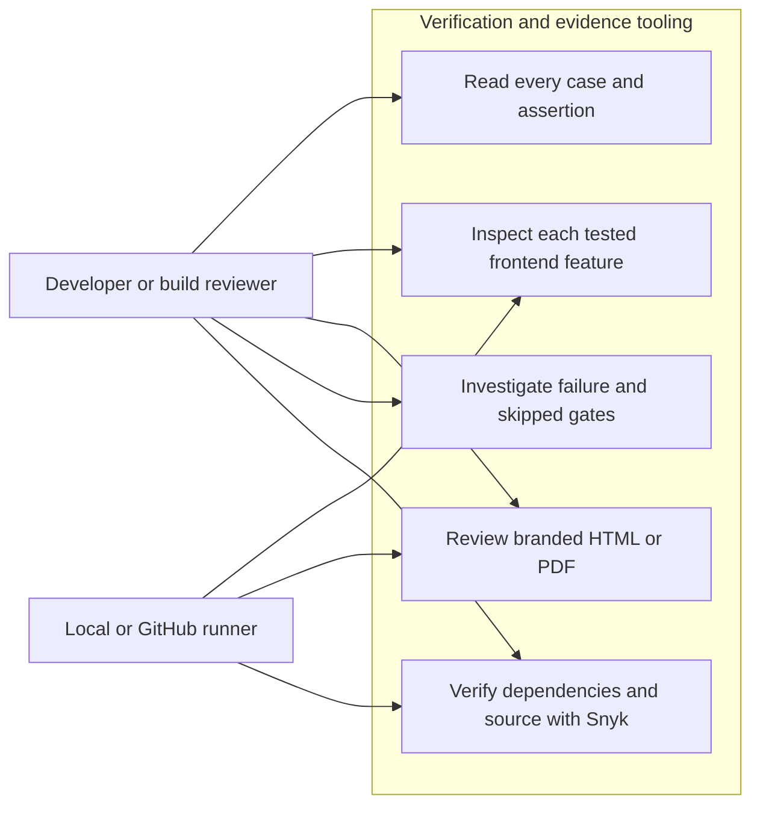
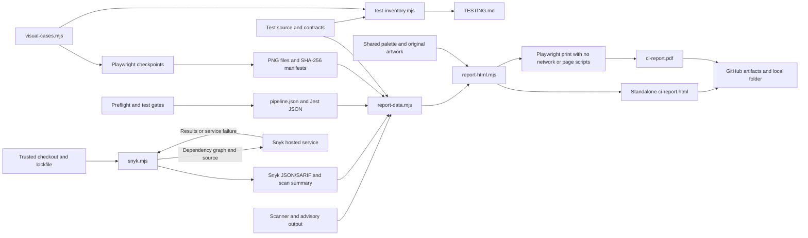
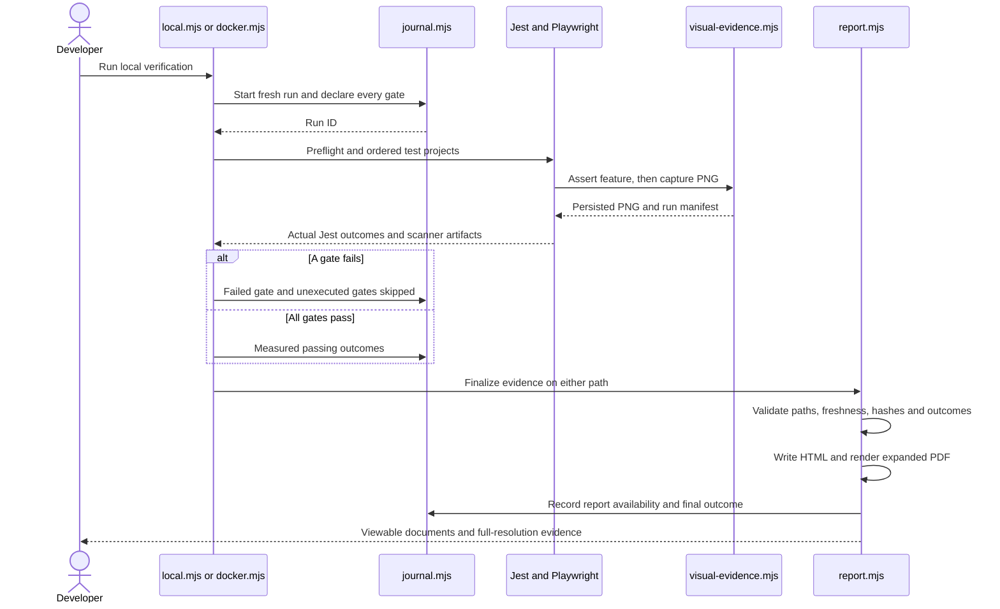
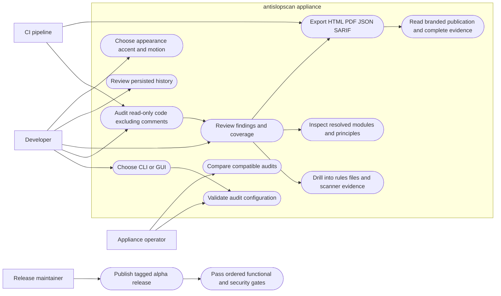
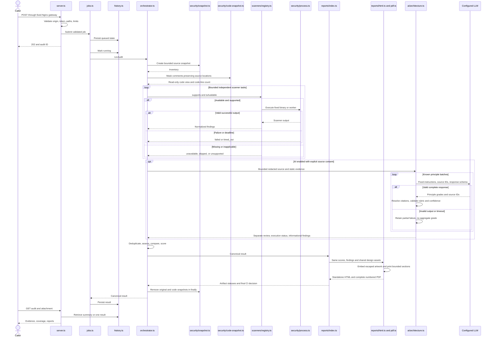

# antislopscan architecture

antislopscan is a TypeScript modular monolith with a Vue interface, Fastify API,
SQLite history, and isolated scanner processes. Core audits need no external
service. Source repositories are data, never executable configuration.

Compose adds an unprivileged Nginx gateway solely for network isolation. Docker's
internal application network did not publish a reachable host port in deployment
verification. The gateway joins frontend and internal networks, publishes localhost
port 3000, and forwards to the monolith. It has no source or history mounts.
The gateway streams upstream responses with `proxy_buffering off`, avoiding
temporary-file spooling into its 16 MiB tmpfs for large PDF/HTML downloads. This
changes delivery buffering only; report content and API endpoints are unchanged.
See the [Nginx directive documentation](https://nginx.org/en/docs/http/ngx_http_proxy_module.html#proxy_buffering).

## Entry points and connections

[`cli.ts`](../src/cli.ts) invokes [`orchestrator.ts`](../src/orchestrator.ts) for
`cli` one-shot audits or starts [`server.ts`](../src/server.ts) through `gui`.
The executable [`antislopscan`](../antislopscan), npm scripts, and npm bin all reach
this entry point. CLI mode requires `--output`, publishes only into that folder,
and prints its canonical location and exit status. GUI accepts `--source` and
`--data`, prints the browser URL, and owns the server lifecycle. `audit`/`serve`
remain compatible aliases. [`environment.ts`](../src/environment.ts) resolves
`ANTISLOPSCAN_*` settings before legacy `CODESENTRY_*` fallbacks. The server serves the
built [`Vue workbench`](../ui/App.vue), validates HTTP authority and source paths,
and submits work to [`jobs.ts`](../src/jobs.ts). Its bounded queue executes one
audit at a time. [`history.ts`](../src/history.ts) owns one SQLite connection,
indexed pagination, canonical results, restart recovery, and retention.

`--profile portable` layers Node-only scanner and HTML/JSON/SARIF defaults before
explicit JSON/project settings. `full` retains native/Python/PDF defaults. The
GUI passes the operator-selected profile to its configuration and job endpoints.
Missing explicitly enabled prerequisites still fail rather than disappearing.

The npm package carries compiled application/UI code and the verified production
dependency tree. [`security/installation.ts`](../src/security/installation.ts)
locates fixed scanner entry points from this installation's npm resolution paths,
with a legacy checkout fallback; audited repository configuration never chooses
binaries. [`build-vendor.mjs`](../scripts/build-vendor.mjs) transpiles trusted
MIT rule sources to `dist/vendor/anti-slop` because Node does not strip types in
`node_modules`. Sources, license, and provenance remain included. The package
currently targets Linux x86_64/glibc for its bundled scanner bindings.

The [CI workflow](../.github/workflows/ci.yml) and tag-triggered
[release workflow](../.github/workflows/release.yml) call the same reusable
[verification workflow](../.github/workflows/verify.yml). Its host entry point,
[`scripts/ci/docker.mjs`](../scripts/ci/docker.mjs), builds the pinned appliance
and invokes [`scripts/ci/run.mjs`](../scripts/ci/run.mjs) inside a non-root,
read-only container. The ordered gates are backend Jest coverage, CLI, offline
npm distribution, Playwright UI, security, self-audit, then Snyk. Each gate owns its
log/results and a failed gate prevents later execution. The runner rejects
skipped tests, missing completion records and failed scanner coverage.

[`scripts/ci/process.mjs`](../scripts/ci/process.mjs) removes operator/provider
credentials from subprocess environments and bounds stage execution with process
group cleanup. Tests use temporary repositories, SQLite stores and local provider
fixtures. [`jest.config.mjs`](../jest.config.mjs) defines four projects;
[`jest-transform.cjs`](../scripts/jest-transform.cjs) uses the pinned TypeScript
compiler for ESM test execution. Tests are separately type-checked. The real
Fastify framework is provided through a native-loader Jest environment to support
its require(ESM) dependency on Node 22; application code remains instrumented.

[`security.mjs`](../scripts/ci/security.mjs) runs appliance ESLint/Semgrep,
redacted Gitleaks over fetched Git history and current source files, and the
npm advisory service. [`audit.mjs`](../scripts/ci/audit.mjs) generates reports in a temporary folder
outside the audited source tree, then copies them unchanged into CI evidence
storage and removes temporary output. This preserves application output-path
confinement when local evidence is stored in the checkout.
[`self-audit.mjs`](../scripts/ci/self-audit.mjs) applies
`config/self-audit.json`, requires complete applicable scanner coverage, and
rejects configured architecture-boundary violations independently of scoring.
AI is disabled for these gates. Registry access is needed for dependency
advisories; it is not needed by normal offline repository audits.

[`snyk.mjs`](../scripts/ci/snyk.mjs) independently runs the pinned Snyk dependency
and Code cloud scans against this trusted checkout, including development
dependencies. [`snyk-results.mjs`](../scripts/ci/snyk-results.mjs) validates CLI
exits and JSON/SARIF, retains all reported severities, dependency paths and source
locations, and blocks on high/critical evidence or unsuccessful execution. Its
only credentials are `SNYK_TOKEN` and optional organization selection. The host
wrapper forwards these at container execution time; neither image build nor the
other test/scanner processes receive them. The gate is separate from the runtime
scanner catalog and never scans an operator-submitted repository. Snyk requires
network/service access. [SNYK.md](SNYK.md) documents its scope, installation,
failure behavior and dependency compatibility constraints.

The runtime path hardening in [`orchestrator.ts`](../src/orchestrator.ts) restricts
finding snippets to inventoried files and reuses the bounded no-follow
[`readSource`](../src/security/snapshot.ts) reader. Scanner exceptions become
fixed safe status/message metadata. [`worker.ts`](../src/worker.ts) accepts only
its private working directory's `context.json`, with a 64 MiB input cap. These
changes preserve normal audit/scoring contracts while rejecting unsupported file
access. The parent-scoped npm resolver override is covered by the native
[`uri-resolver.mjs`](../tests/uri-resolver.mjs) compatibility scenario and real
scanner/offline-install tests.

After verification, [`create-release.sh`](../scripts/create-release.sh) extracts
the image's npm archive and Node executable into a Linux x86_64 distribution.
[`portable.mjs`](../scripts/ci/portable.mjs) verifies checksums and runs a real
fixture audit with the extracted executable. Its host requires glibc and `prlimit`.
The Docker wrapper performs these checks locally without publishing. It writes
evidence as the invoking user's UID/GID, so artifact collection needs no broad
permission changes. The test container never receives the Docker socket. Its temporary mount allows
execution for trusted offline package-install smoke tests; production Compose
keeps its `noexec` temporary mount.

Only a successful release verification uploads the exact Docker image and
checksummed archives for the `publish` job. That job has `needs: verify`, validates
the tag against `package.json`, loads the saved image without rebuilding, then
publishes Docker Hub version/alpha tags and a GitHub prerelease. Docker Hub
credentials enter only that job through `DOCKER_TOKEN`; release-write permission
is absent from verification. See [TESTING.md](TESTING.md) for the ten-pillar test
matrix, coverage scope, budgets and evidence locations.

[`prepare-package.mjs`](../scripts/prepare-package.mjs) verifies installed versions
against the authoritative lockfile and copies release provenance into config.
The `package.json` release allowlist includes public configuration files and
top-level Markdown documentation. Local agent instructions, operator settings,
audit outputs and article drafts are excluded; Docker also excludes the drafts
from its build context. Package installation tests verify these exclusions.
[`package.mjs`](../tests/package.mjs) installs the actual tarball offline into
fresh global/local prefixes, executes the npm scanner set, verifies report
folders, and starts/stops the packaged GUI. No developer installation is reused.

The orchestrator connects the following responsibilities in order:

1. [`config.ts`](../src/config.ts) validates against
   [`config-schema.ts`](../src/config-schema.ts), applies project overrides, and
   fingerprints the effective policy and pinned tool versions.
2. [`security/paths.ts`](../src/security/paths.ts) confines paths.
   [`security/snapshot.ts`](../src/security/snapshot.ts) inventories and copies
   bounded source through no-follow descriptors. Symlinks and repository
   executable configuration are excluded. Private agent settings (`.codex`,
   `.agents`), AWS credentials (`.aws`), and npm caches (`.npm-cache`) are never
   traversed. Package metadata contributes names only.
3. [`scanners/registry.ts`](../src/scanners/registry.ts) implements the common
   [`ScannerAdapter`](../src/domain.ts) contract for every internal/external tool.
   [`catalog.ts`](../src/scanners/catalog.ts) declares versions, languages,
   categories, and reasons for integrations that remain unavailable.
4. [`security/process.ts`](../src/security/process.ts) runs fixed appliance
   binaries with a clean environment, output limits, process-group cleanup,
   deadlines, Node heap limits, and Linux resource controls.
   [`worker.ts`](../src/worker.ts) isolates the core engine and
   [`ESLint`](../src/scanners/eslint.ts). [`external.ts`](../src/scanners/external.ts)
   generates trusted tool configuration. [`normalize.ts`](../src/scanners/normalize.ts)
   rejects malformed scanner output rather than inventing a clean result.
   SlopScore uses its UTF-8 `--out` file mode because its immediate `process.exit`
   can truncate large piped JSON. File-based scanner reports are checked against
   the configured output cap before parsing, alongside subprocess/file limits.
5. [`findings.ts`](../src/findings.ts) redacts, fingerprints, and deduplicates
   findings, preserving provenance and the strongest supported assessment.
   [`scoring.ts`](../src/scoring.ts) calculates evidence-density scores and
   separate quality, coverage, execution, and artifact-generation CI gates.
6. [`analysis/erosion.ts`](../src/analysis/erosion.ts) compares compatible
   measurements. Without a baseline its result is labeled current structural risk.
7. [`reports/index.ts`](../src/reports/index.ts) stages artifacts from the canonical
   result, records PDF failure explicitly, calculates the final CI decision, and
   publishes files. [`result-schema.ts`](../src/result-schema.ts) validates
   canonical JSON before publication or baseline use.
8. The orchestrator removes the source snapshot in `finally`. API jobs persist
   the result; CLI jobs return the configured exit code.

## Delivery verification sequence

The local Docker command and GitHub use the same runner. Evidence belongs to the
verification run, while publication credentials belong only to the release job.
An unsuccessful run never supplies artifacts to a publishing job.

```mermaid
sequenceDiagram
    actor Developer
    participant Wrapper as scripts/ci/docker.mjs
    participant Runner as scripts/ci/run.mjs
    participant Jest as Jest projects and Playwright
    participant Security as security.mjs
    participant Self as self-audit.mjs
    participant Snyk as snyk.mjs
    participant Cloud as Snyk hosted analysis
    participant Store as artifacts/ci
    participant Publish as release.yml publish
    Developer->>Wrapper: npm run ci:docker or alpha tag
    Wrapper->>Wrapper: Build pinned image and preflight
    Wrapper->>Runner: Non-root container, read-only app and Git history
    Runner->>Jest: Backend coverage, CLI, distribution, UI in order
    Jest-->>Runner: Results and bounded diagnostics
    alt A functional gate fails
        Runner->>Store: Failed summary; later gates skipped
        Runner-->>Wrapper: Nonzero exit
    else Functional gates pass
        Runner->>Security: SAST, Git-history secrets, dependency advisories
        Security-->>Runner: Explicit completion or failure
        Runner->>Self: Only after security passes
        Self-->>Runner: Quality, coverage and boundary result
        Runner->>Snyk: Only after self-audit passes; scoped token
        Snyk->>Cloud: Dependency graph and supported source files
        Cloud-->>Snyk: Dependency JSON and Code SARIF or service error
        Snyk-->>Runner: Separate completion/counts; high/critical gate
        Runner->>Store: Summary, coverage, reports and traces
        Runner-->>Wrapper: Nonzero unless every gate passed
        Wrapper->>Wrapper: Assemble and smoke-test executable archive
        opt Alpha tag and all checks passed
            Wrapper->>Store: Saved verified image and archives
            Publish->>Store: Download verified release assets
            Publish->>Publish: Validate tag, checksums, publish
        end
    end
```

## CI documentation and report evidence

This is development/delivery tooling, separate from the runtime audit API. It
adds no application routes or scoring categories. Runtime source-access
hardening is described above; the report's frontend and scoring semantics remain
unchanged.

[`test-inventory.mjs`](../scripts/ci/test-inventory.mjs) parses registered Jest
source and delegated browser/package scenarios using TypeScript. It extracts
contracts and real assertion expressions into the generated portion of
[TESTING.md](TESTING.md). `check:testing` rejects drift before running tests.
[`visual-cases.mjs`](../tests/visual-cases.mjs) declares every required screenshot,
including all tested appearance/viewport combinations. The same registry supplies
the documentation table and browser evidence requirements.

[`visual-evidence.mjs`](../tests/helpers/visual-evidence.mjs) captures UI states
after assertions, masks only visible password inputs, and records each PNG's
SHA-256, actual dimensions, viewport and capture time. It saves partial progress
on failure and rejects a successful scenario missing any required image.
[`journal.mjs`](../scripts/ci/journal.mjs) owns a fresh run ID and atomic stage
transitions. [`local.mjs`](../scripts/ci/local.mjs) records native preflight;
Docker records provisioning/build, cleanup and archive/executable steps. The
shared runner records functional/security gates without conflating fixture error
logs with failed tests.

[`report-data.mjs`](../scripts/ci/report-data.mjs) joins actual Jest outcomes to
source contracts, verifies current-run manifests, confines regular artifact paths,
rejects stale/oversized evidence and validates PNG checksums. It never fills a
missing outcome with a pass. It also verifies the Snyk run ID and recomputes
normalized issues from fresh raw JSON/SARIF before accepting scan summaries.
[`report-html.mjs`](../scripts/ci/report-html.mjs)
escapes all report evidence and reuses the existing mark, topology artwork and
shared palette through [`ci-report.css`](../assets/ci-report.css).
[`report.mjs`](../scripts/ci/report.mjs) writes standalone HTML, then renders all
expanded details to A4 through the existing Playwright/Chromium dependency with
page JavaScript and networking disabled. Print time is bounded, page numbers are
included, and an unavailable PDF remains an explicit failure in `report-status.json`.

Managed commands generate reports in their failure/success finalization path.
The journal's report outcome and overall status remain failed if report generation
or evidence validation fails. Preflight failures can still produce a failure
report if renderer dependencies exist; otherwise HTML explains the unavailable
PDF. Release publication remains a distinct job and is explicitly pending/not
requested in verification reports. GitHub always retains a dedicated
`antislopscan-ci-report` artifact and raw evidence, while
[`job-summary.mjs`](../scripts/ci/job-summary.mjs) links the documents and displays
actual gate outcomes.



The use cases are implemented by the source inventory, browser checkpoint helper
and filesystem report entry points above. These are not new web application APIs.



The run owns its journal and captured fixture evidence. Report collection reads
only bounded files under that run's evidence root. Source inventories describe
intended checks; only Jest outcomes establish which cases actually passed.



## Comment exclusion and source views

[`security/code-snapshot.ts`](../src/security/code-snapshot.ts) derives a second,
read-only scanner view from the bounded original snapshot. Every scanner consumes
the code view; original file hashes, physical inventory counts and optional report
context remain tied to the untouched source. Both snapshots are removed in the
orchestrator's `finally` path. Temporary source storage can reach twice the
configured repository limit. Failure to construct the view fails the audit rather
than silently scanning unfiltered text.

[`analysis/comments.ts`](../src/analysis/comments.ts) uses TypeScript compiler
locations for JS/TS/JSX, Vue script/template parsing with explicit AST comment retention in production
and development, and lexical comment spans for
other supported languages. Comments become spaces, retaining UTF-16 columns and
newlines. Quoted/raw strings, regex literals and template text remain code data.
Non-JS/TS lexical handling is not a complete semantic parser. Native language
adapters retain their existing syntax/error reporting.

The core clone engine compares nonblank code lines, retaining original positions.
Module metrics and score density also use nonblank code lines. Comment-only
markers and decorative-comment rules are disabled, as is the Oxlint rule requiring
a safety comment. SlopScore physical-size rule 055 is replaced by the core code-line
metric; jscpd explicitly uses `--skip-comments`. LLM source windows and citations
come exclusively from the code view. Supplied architecture documents remain
optional requirements context and cannot independently earn a source-backed grade.
The `code-only-v1` policy marker changes the configuration fingerprint so audits
using the previous comment policy cannot become a misleading erosion baseline.

## Review and reporting presentation

[`review.ts`](../src/review.ts) is a browser-safe, pure module shared by the
frontend and reports. It groups complete canonical findings, applies exact
composable filters and deterministic sorting, and resolves curated HTTPS issue
references. Finding text cannot supply a destination URL. Links use no-referrer
navigation, and neither report reading nor dashboard interactions fetch external
data. Documentation may describe a newer tool version; execution versions remain
the pinned versions displayed with the scan.

[`App.vue`](../ui/App.vue) owns configuration, history, authentication, downloads,
and selected audit state. [`AuditDashboard.vue`](../ui/AuditDashboard.vue) emits
exact evidence slices to [`FindingsExplorer.vue`](../ui/FindingsExplorer.vue),
which filters before 50-item pagination and exports the entire filtered selection.
[`AuditHero.vue`](../ui/AuditHero.vue) separates the exact overall quality gauge
from CI gate status, execution coverage, findings, and export availability.
[`ScoreGauge.vue`](../ui/ScoreGauge.vue), [`MetricCard.vue`](../ui/MetricCard.vue),
[`UiIcon.vue`](../ui/UiIcon.vue), and [`presentation.ts`](../ui/presentation.ts)
reuse display conventions without changing canonical values.
[`CoveragePanel.vue`](../ui/CoveragePanel.vue) keeps execution status, scoring
methodology, penalty contributions, and detector confidence explicit.
[`ArchitecturePanel.vue`](../ui/ArchitecturePanel.vue) presents connectivity,
cycles, grouped findings, and searchable principle assessments.
[`DependencyGraph.vue`](../ui/DependencyGraph.vue) uses the pure tested
[`graph-layout.ts`](../ui/graph-layout.ts) to bound the radial display to 32 real
modules and 100 real edges. It ranks by canonical connectivity, filters paths with
one-hop neighbors, and distinguishes type-only imports. Geometry organizes data;
it infers neither architectural layers nor causality. Node inspection and a
native module selector expose exact metrics and incident imports, with evidence
drill-down. Its relationship table renders at most 100 matches; canonical JSON
retains every edge. Empty graphs and unassessable concepts remain explicit.
UI review URLs identify a persisted audit through `?audit=UUID` without bypassing
bearer authentication. Findings copy uses the browser clipboard with a visible
denial fallback; no executable repository content is interpreted.

[`theme.ts`](../ui/theme.ts) persists separate appearance, accent, and optional
background-motion preferences. Existing saved appearance/accent choices are
preserved. Fresh installs follow the new dark-first intelligence brief with a
teal accent; malformed stored accents safely fall back to neutral through
[`appearance.ts`](../ui/appearance.ts). [`palette.css`](../ui/palette.css) imports
the shared [`theme.css`](../assets/theme.css) tokens: light/dark/OS surfaces,
seven accents, semantics, spacing, radii, motion, and shadows.
[`style.css`](../ui/style.css) owns the shell and global controls;
[`dashboard.css`](../ui/dashboard.css) owns hero, metrics, and charts;
[`evidence.css`](../ui/evidence.css) owns findings, coverage, and architecture.
No new framework, chart library, icon package, external font, or runtime dependency
was introduced. Pinned development-only `vue-tsc` checks Vue templates as well as
TypeScript; Vite still builds the existing frontend.

The original Imagegen PNGs in [`intelligence/`](../assets/branding/intelligence/README.md)
are illustrative identity material. [`NetworkBackdrop.vue`](../ui/NetworkBackdrop.vue)
blends topology behind the hero and owns a cleaned-up document visibility listener.
CSS path flow pauses with the user's control or a hidden tab, and reduced-motion
disables it. Only measured graph data appears in the dependency explorer.
Accent selection affects actions, links, quality charts, selections, and focus;
severity colors retain their meaning. Storage restrictions leave controls usable
with a persistence notice. Native header disclosures support Escape and exclusive
opening; the assessment expands without adding routes or changing POST semantics.
On phones, the sticky shell keeps assessment and history actions available.
Choosing a history entry restores focus to its repository heading; polling does
not move focus. Settings popovers stay within the viewport and evidence anchors
reserve space for the shell and review navigation.
Browser-safe [`presentation/`](../src/presentation/) modules own the original
icons, category names, accent choices and principle illustrations/explanations.
Small compatibility exports under `ui/` preserve existing imports. The
original [`brand mark`](../assets/branding/antislopscan-mark.png) is
bundled by Vite; the server's confined asset route permits PNG as well as JS/CSS.

[`reports/presentation.ts`](../src/reports/presentation.ts) embeds fixed local
brand/topology PNGs, four static principle posters and original SVG symbols once
per document. It renders the score-led cover, exact-value gauges, provenance and
publication timestamp. Artwork is explicitly conceptual. The shared theme feeds
[`report.css`](../assets/report.css), whose responsive layout and white A4 print
rules provide publication typography, chapter hierarchy, repeated table headers
and compact evidence. Print has no animation.

[`reports/html.ts`](../src/reports/html.ts) composes that presentation,
[`dashboard.ts`](../src/reports/dashboard.ts), the separate
[`ai-architecture.ts`](../src/reports/ai-architecture.ts) summary, unified
[`principles.ts`](../src/reports/principles.ts) static/LLM evidence and a CSP-hashed
local filtering script. All source strings are escaped. HTML disclosures remain
usable without JavaScript; JS adds filtering, sorting, pagination and saved
theme/accent selection. Actual scores, finding identities, graph edges and
citations are unchanged; JSON and SARIF serializers receive the same canonical
result. PDF
rendering in [`pdf.ts`](../src/reports/pdf.ts) disables JavaScript and networking,
forces the light print palette, and renders at most 250 findings per Chromium
section. Large reports retain full canonical statistics in their opening summary
and put every finding into an ordered evidence appendix. Pinned MIT `pdf-lib`
merges every generated page and adds a restrained brand footer and global page
numbers. A section has a
60-second print budget; the whole PDF has a ten-minute budget and a 50,000-finding
limit. Larger inputs fail the PDF artifact explicitly while HTML/JSON/SARIF
remain available. No arbitrary uploaded PDF is parsed. All four artifacts
continue to derive from the same canonical result.

## Independent engine

[`analysis/engine.ts`](../src/analysis/engine.ts) combines source structure,
duplication indicators, supplied requirements, and import edges independently of
external scanners. [`source.ts`](../src/analysis/source.ts) extracts Vue scripts
without execution and preserves original line numbers. [`ast.ts`](../src/analysis/ast.ts)
uses the TypeScript parser and resolves relative imports against the inventory.
[`graph.ts`](../src/analysis/graph.ts) finds strongly connected components with
iterative traversal. Type-only edges are excluded from runtime cycle penalties.
Fan-in/out measurements identify structural review candidates.

[`policies.ts`](../src/analysis/policies.ts) defines each design, architecture,
and systems principle with methodology, evidence, severity, confidence, score
impact, recommendations, false positives, and assessment status. Static imports
are not interpreted as causal or feedback loops. Unobservable principles remain
explicitly unassessable. Missing capabilities are only considered against supplied
requirements; textual absence alone is still a review indicator.

## Use case diagram

Mermaid flowchart notation represents actors, use cases, and the appliance
boundary. Developers use the CLI/UI, pipelines use CLI/API, and operators own
source mounts, configuration, access, and persistence.



## Data flow diagram

The caller owns the repository; the appliance owns temporary snapshots, canonical
results, SQLite, and report artifacts. Only explicitly enabled AI can send bounded
source data across an external-service boundary.

```mermaid
flowchart LR
    input[CLI flags or API JSON] --> config[config.ts]
    repo[(Read-only source)] --> snapshot[security/snapshot.ts]
    config --> snapshot
    snapshot --> private[(Private temporary snapshot)]
    private --> projection[security/code-snapshot.ts and analysis/comments.ts]
    projection --> code[(Comment-masked code and code-line count)]
    code --> registry[scanners/registry.ts]
    registry --> worker[worker.ts and independent engine]
    registry --> external[External scanner processes]
    worker --> canonical[findings.ts]
    external --> canonical
    canonical --> scoring[scoring.ts and erosion.ts]
    baseline[(Compatible prior result)] --> scoring
    scoring --> result[Canonical AuditResult]
    result --> reports[reports/index.ts]
    result --> review[review.ts evidence grouping and references]
    review --> reports
    design[Shared presentation modules and theme tokens] --> reports
    artwork[(Bundled illustrative PNGs)] --> reports
    result --> sqlite[(SQLite history)]
    reports --> files[(HTML PDF JSON SARIF)]
    tag[Alpha release tag] --> verification[verify.yml and scripts/ci/docker.mjs]
    verification --> gates[scripts/ci/run.mjs ordered gates]
    gates --> evidenceStore[(Jest coverage traces and audit artifacts)]
    gates -->|All passed| verified[(Verified image and tested archives)]
    verified --> release[release.yml publish job]
    release --> image[(Docker Hub image)]
    release --> archive[(Executable and npm archives)]
    sqlite --> api[Fastify review API]
    files --> api
    api --> gateway[Unprivileged Nginx gateway]
    gateway --> vue[Vue workbench]
    review --> vue
    design --> vue
    vue --> graphview[DependencyGraph.vue]
    graphview --> layout[graph-layout.ts bounded geometry]
    layout --> graphview
    graphview -->|File evidence slice| vue
    artwork --> backdrop[NetworkBackdrop.vue]
    backdrop --> vue
    vue -->|User copy action| clipboard[(Browser clipboard)]
    vue --> preferences[(Browser appearance accent motion preferences)]
    preferences --> vue
    worker --> evidence[ai/evidence.ts bounded source catalog]
    external --> evidence
    code -. explicit consent .-> evidence
    evidence --> ai[ai.ts deferred optional review]
    ai -. bounded HTTP request .-> provider[Configured LLM provider]
    provider -. untrusted model response .-> validation[ai/assessment.ts citations and rubric]
    validation --> canonical
    validation --> result
```



Scanner failure contributes execution status and missing coverage, never fabricated
findings. The independent engine runs through an internal adapter/worker. Diagram
nodes represent responsibilities inside one deployment, not microservices.

## Sequence diagram

This sequence shows an API audit. The CLI calls the same orchestrator directly.
Scanner tasks execute with bounded parallelism and independent error boundaries.



For releases, a maintainer pushes an alpha tag. GitHub Actions builds the image,
extracts and verifies the portable archive, authenticates to Docker Hub using
the repository secret, then publishes the images and GitHub prerelease. A failed
verification stops publication; publication errors remain visible in Actions.

## Runtime, ownership, and failure boundaries

Docker runs Node under `tini` as UID/GID 1000. Compose makes the root filesystem
read-only, drops capabilities, bounds memory/PIDs/CPU/tmpfs, mounts source
read-only, and uses an internal network. `/data` owns history and API reports;
`/reports` is the CLI output mount selected by `--output`. Compose retains the
legacy `codesentry-data` volume key so renaming the service/image preserves history.
Local GUI state defaults outside the source tree to the user's state directory.
Installed binaries, profiles, rules, npm/Python
packages, and Chromium assets support offline execution.

JSON is the configuration authority. API clients cannot choose binaries,
arbitrary host paths, output destinations, or local baseline files. Requested
missing tools fail the default execution policy. Exceptions reach the CLI/API/job
boundary through safe structured logging. Shutdown owns queued-job failure,
active scanner cancellation, temporary-file cleanup, browser closure, and SQLite
teardown. A single process owns each database volume.

[`ai.ts`](../src/ai.ts) dispatches legacy advisory review or separately scored
principle assessment. [`ai-settings.ts`](../src/ai-settings.ts) layers trusted
deployment settings, provider endpoint/key-variable presets and explicit CLI
overrides. The installed CLI loads dotenv only through `--env-file`; checkout
npm entry scripts explicitly load their own optional `.env`. GUI operator JSON
becomes default configuration while the API pins provider protocol, URL and
credential-variable authority. The browser never receives key values.

The orchestrator finishes static scanner work before optional semantic review.
[`ai/evidence.ts`](../src/ai/evidence.ts) selects bounded, redacted source windows
using static risk priority and path spread, with bounded graph/finding context.
Leading attribution/license headers are excluded from source windows without
renumbering citations. This reserves the limited source budget for implementation
evidence; model instructions also exclude legal boilerplate from design judgments.
[`ai/assessment.ts`](../src/ai/assessment.ts) assigns immutable excerpt IDs,
requires complete known principle batches and resolves model-selected IDs into
checked source citations. Its rubric excludes uncertain/inapplicable principles
and confidence below 60%; partial execution has no aggregate score.
[`ai/architecture.ts`](../src/ai/architecture.ts) owns sequential batches and
partial-failure provenance. [`ai/transport.ts`](../src/ai/transport.ts) implements
native Ollama and Claude plus OpenAI/OpenRouter/compatible chat requests using
bounded Node fetch, no redirects, no automatic retries and no tool execution.
The outer audit deadline and per-request timeout both apply.

Optional `AuditResult.aiArchitecture` preserves backward readability of historical
results. It records model/provider, rubric, source scope, per-principle grades,
citations, uncertainty and errors. The separate LLM score does not change core
deterministic scores or CI thresholds; model risk findings are informational by
default. Requested AI execution failure still reduces coverage and follows the
configured scanner-error gate. HTML/PDF show the independent summary through
[`reports/ai-architecture.ts`](../src/reports/ai-architecture.ts) and all principle
assessments/citations through [`reports/principles.ts`](../src/reports/principles.ts).
JSON and SARIF retain the canonical review. Historical artifacts are not
automatically rewritten; an explicit presentation refresh changes only HTML/PDF
attachments, retaining the canonical result and machine-readable artifacts.

[`PrinciplesPanel.vue`](../ui/PrinciplesPanel.vue) joins static and LLM evidence
without overwriting either, filters/paginates 14 rows, and links exact source or
rule slices. [`AiSettingsPanel.vue`](../ui/AiSettingsPanel.vue) edits the same JSON
submitted by the existing form while exposing operator pins.
[`PrincipleIllustration.vue`](../ui/PrincipleIllustration.vue) switches Imagegen
GIFs to static posters when closed, paused, hidden or reduced-motion is active.
The original sheets, exact prompts and deterministic conversion are recorded in
[`principles/README.md`](../assets/branding/principles/README.md).

Generic defaults disable AI and retain the internal Compose network. This user's
ignored `.env` explicitly enables local provider over its existing Ollama HTTP port 11434
and changes `ANTISLOPSCAN_NETWORK_INTERNAL` to false. In that opted-in deployment,
outbound network access is available to the appliance, not isolated per scanner;
scanner child environments still exclude provider credentials. See
[`LLM_SETUP.md`](LLM_SETUP.md) for provider/API, network and scoring contracts.

See [`SECURITY.md`](SECURITY.md) for isolation limits and
[`TOOL_RESEARCH.md`](TOOL_RESEARCH.md) for adapter constraints. Git-history/co-change
analysis, full project type checking, semantic architecture drift, and safe
adapters for unavailable tools remain explicitly unimplemented optional work.
