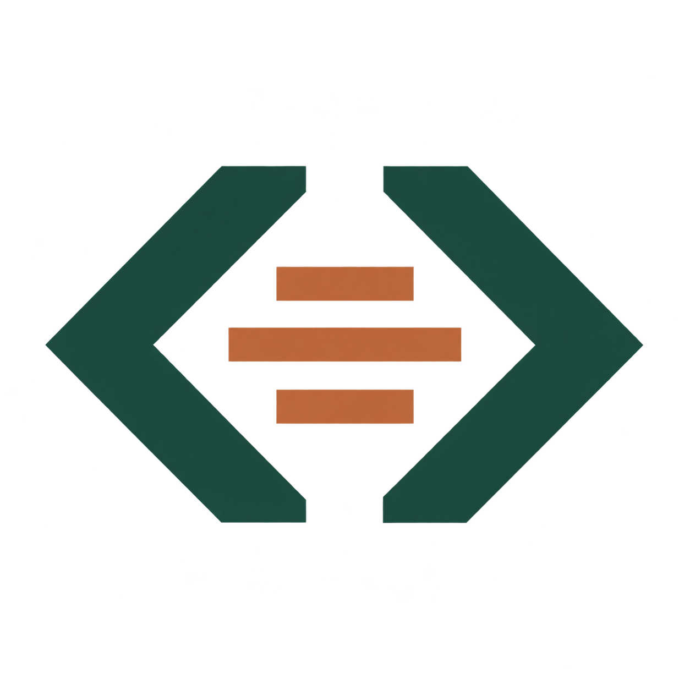

# AntiSlopScan



AntiSlopScan is an open-source, self-hosted appliance for auditing code quality, AI-generated code smells, security indicators, architecture and systems-thinking practices. It combines independent structural analysis with established scanners and produces **HTML, PDF, JSON and SARIF** reports.

The appliance scans repositories as data: it does not install their dependencies or run their scripts. Scanner failures and missing coverage are reported separately from findings. Core analysis works offline after the image is installed. Optional LLM-assisted architecture review is disabled by default and requires explicit source-transmission consent.

**Alpha release:** this image currently targets Linux x86_64 (`linux/amd64`). Use `1.0.0-alpha.2` for a specific release or `alpha` for the current alpha image.

## One-shot audit

Create a writable reports directory outside the repository, then use absolute paths for both mounts:

```sh
docker run --rm --network none \
  -v /absolute/path/to/source:/workspace:ro \
  -v /absolute/path/to/reports:/reports \
  jfscoertzen/antislopscan:1.0.0-alpha.2 \
  cli --source /workspace --output /reports
```

The container runs as UID/GID 1000. The source must be readable and the reports directory must be writable by that user. Reports are written as `report.html`, `report.pdf`, `report.json` and `report.sarif.json`. The command returns a CI exit code: 0 for pass, 1 for a quality-gate failure, 2 for scanner/report failure and 3 for invalid configuration or input, unless configured otherwise.

To use a JSON policy, mount it read-only and add `--config /config/config.json`:

```sh
docker run --rm --network none \
  -v /absolute/path/to/source:/workspace:ro \
  -v /absolute/path/to/reports:/reports \
  -v /absolute/path/to/config.json:/config/config.json:ro \
  jfscoertzen/antislopscan:1.0.0-alpha.2 \
  cli --source /workspace --output /reports --config /config/config.json
```

## Self-hosted web interface

Clone the repository and start the provided Compose appliance:

```sh
git clone https://github.com/jfscoertzen/AntiSlopScan.git
cd AntiSlopScan
ANTISLOPSCAN_SOURCE=/absolute/path/to/repositories docker compose up -d --build
```

Open <http://localhost:3000>. The source mount is read-only and audit history is stored in a Docker volume. Compose binds the gateway to localhost. Set `ANTISLOPSCAN_API_TOKEN` when bearer authentication is required. Review the security and network configuration before exposing the service beyond your machine.

## Documentation and support

- [Project README and configuration](https://github.com/jfscoertzen/AntiSlopScan#readme)
- [Alpha releases and Linux executable](https://github.com/jfscoertzen/AntiSlopScan/releases)
- [Optional LLM provider setup](https://github.com/jfscoertzen/AntiSlopScan/blob/main/docs/LLM_SETUP.md)
- [Security model and responsible disclosure](https://github.com/jfscoertzen/AntiSlopScan/blob/main/docs/SECURITY.md)
- [Source and issue tracker](https://github.com/jfscoertzen/AntiSlopScan)

Licensed under Apache-2.0; bundled tools retain their respective licenses. Scores are evidence-based indicators and require review in context; they are not a security certification.
